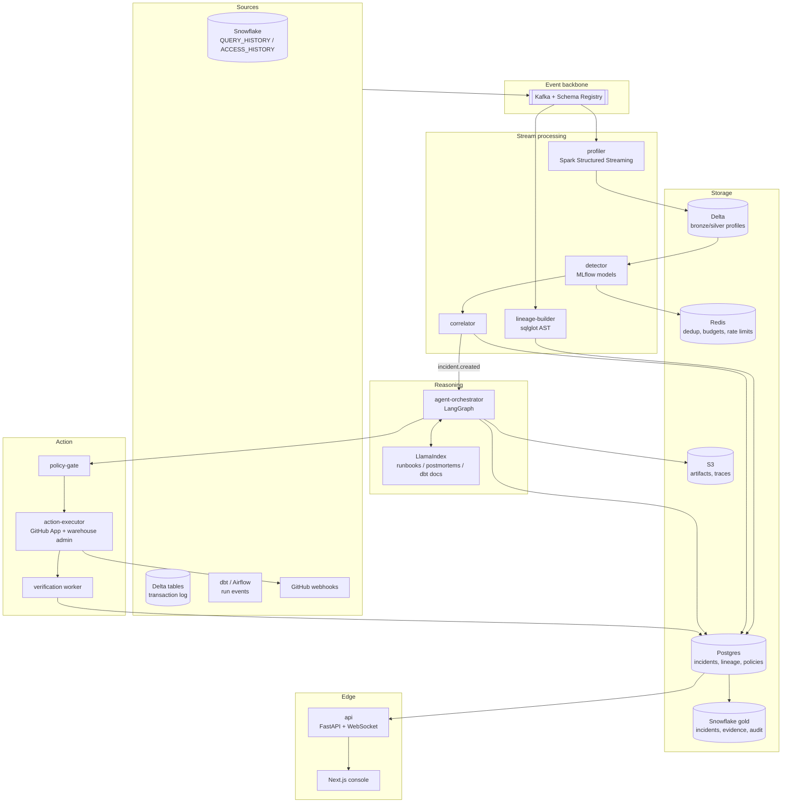
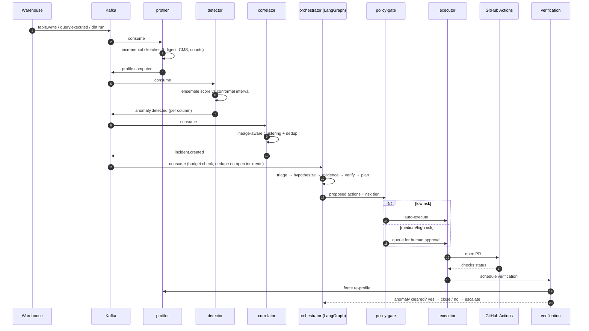
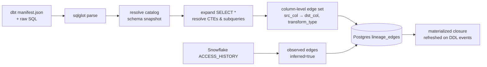

# 02 — Architecture

## 1. Design principles

1. **Closed loop.** Every path ends in a verified outcome, not a notification.
2. **Statistics detect; LLMs reason; deterministic code acts.** No blurring.
3. **Evidence or it didn't happen.** Every agent claim references a stored artifact by ID.
4. **Segregation of duties.** The reasoning identity is read-only. A separate identity mutates.
5. **Cost is a first-class constraint.** Every incident has a token and dollar budget.
6. **Everything replayable.** Kafka retention + Delta time travel means any incident can be re-run against a new detector or a new prompt.

## 2. Component architecture

## 3. Service catalog

| Service | Runtime | Responsibility | Scaling unit |
|---|---|---|---|
| `ingestion-gateway` | FastAPI + Kafka producer | Receives webhooks, polls warehouse metadata, validates against Avro schemas | Stateless, HPA on RPS |
| `profiler` | Spark Structured Streaming | Incremental column profiles → Delta silver | Spark partitions by `table_id` |
| `lineage-builder` | Python worker | Parses SQL to column-level edges; upserts graph | Partitioned by repo/model |
| `detector` | Python worker | Loads MLflow models, scores profile vectors, emits anomalies | Stateless, partition-parallel |
| `correlator` | Python worker | Groups anomalies into incidents (lineage + temporal) | Single writer per lineage component; sharded by root component id |
| `agent-orchestrator` | FastAPI + async workers | Runs the LangGraph RCA; long-lived, IO-bound | Queue depth |
| `policy-gate` | Library + service | Evaluates action risk tier against declarative policy | In-process |
| `action-executor` | Python worker | GitHub PRs, quarantine, feature-view pin | Rate-limited by GitHub API |
| `verification-worker` | Python worker | Re-profile check post-merge; close or escalate | Cron + event |
| `api` | FastAPI | REST + WebSocket fanout, authn/z, audit middleware | Stateless |
| `web` | Next.js | Console | CDN + SSR |

**Why the orchestrator is a separate service from the API:** completely different scaling and failure profile. Agent runs are minutes-long, memory-heavy, and cost money; API requests are milliseconds. Coupling them means one bad incident storm takes down the UI.

## 4. Primary sequence — detection to closure

## 5. Lineage build path

Two lineage sources, deliberately:
- **Declared** (parsed from SQL) — precise, but blind to non-SQL transforms.
- **Observed** (from `ACCESS_HISTORY`) — catches everything but is coarser and lags.

Edges carry `source ∈ {declared, observed}` and `confidence`. Disagreement between them is itself a signal worth surfacing.

## 6. Agent boundary (detail in `05-agent-design.md`)

The orchestrator is the only component that talks to an LLM. It receives an `Incident` and returns an `RCAResult`. Everything it can do is a registered, typed, **read-only** tool. It cannot mutate anything; it emits an `ActionPlan` that a different process evaluates and executes.

## 7. Failure modes and responses

| Failure | Blast radius | Mitigation |
|---|---|---|
| Kafka lag spike | Delayed detection | Consumer lag alert; profiler drops to sampled profiling above a lag threshold and marks profiles `degraded=true` |
| Detector model load failure | No anomalies | Fail closed to the previous MLflow model version; health check fails the deploy |
| LLM provider outage/timeout | No RCA | Incident still created with anomalies + blast radius; RCA queued with exponential backoff; UI shows `rca_pending` honestly |
| Agent infinite loop | Cost blowout | Hard caps: max 12 node transitions, max 25 tool calls, max $0.50 per incident; breach → terminate with `budget_exceeded` |
| Prompt injection via column values | Bogus RCA or attempted action | Only statistics enter prompts (ADR-010); agent identity is read-only (ADR-008); executor validates the action against a fixed enum, never against LLM free text |
| Lineage parse failure on exotic SQL | Missing blast radius | Fall back to observed lineage; mark model `unparsed` and surface parse-coverage % as a health metric |
| Alert storm (100 incidents at once) | Cost + noise | Global rate limit on agent runs; incidents queue by criticality; automatic "storm mode" that correlates aggressively and raises one meta-incident |
| Bad auto-remediation | Data harm | Only `low`-risk actions auto-execute; all actions are reversible by construction; verification loop detects non-clearing and escalates |
| Postgres closure table stale after DDL | Wrong blast radius | DDL events invalidate the affected subtree; closure refresh is incremental and its lag is a monitored metric |

## 8. Consistency and delivery semantics

- Kafka consumers are **at-least-once**; every downstream write is idempotent on a natural key (`profile_id = hash(table_id, column, window_end)`; `anomaly_id = hash(profile_id, detector_id)`).
- Incident creation uses an advisory lock per lineage component to prevent two correlator instances creating duplicate incidents.
- Action execution is idempotent on `action_id`; the executor checks for an existing PR with the incident ID in its branch name before creating one.
- Profiles are append-only; corrections arrive as new rows with a later `computed_at`, never updates.

## 9. Environments

| Env | Purpose | Data |
|---|---|---|
| `local` | Full loop on a laptop via docker-compose | Synthetic warehouse in Postgres/DuckDB, Redpanda, MinIO |
| `staging` | Nightly chaos runs, CI integration tests | Synthetic warehouse in Snowflake trial |
| `demo` | Recorded demo + live interview walkthrough | Same as staging, curated incidents |

There is deliberately no `prod` — this is a portfolio system. Say so; pretending otherwise is the kind of inflated claim that gets caught in interviews. What *is* true is that it is built to production standards (IaC, gates, SLOs, security model), and that is the defensible claim.

## 10. Performance budget

| Stage | p95 target |
|---|---|
| Warehouse write → Kafka event | 5 s |
| Kafka → profile computed | 30 s |
| Profile → anomaly emitted | 10 s |
| Anomaly → incident correlated | 15 s |
| Incident → RCA complete | 90 s |
| Blast radius traversal (depth 8) | 300 ms |
| API read endpoints | 200 ms |
| WebSocket incident push | 1 s |

Total detection-to-diagnosis: **≤ 2.5 minutes p95**. This number is the headline. Instrument it as a single OTel trace spanning all services, keyed by `incident_id`.
